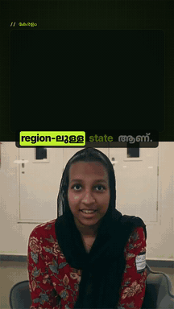
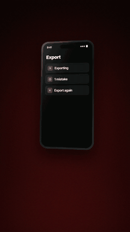
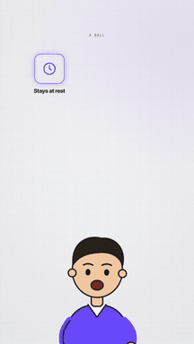
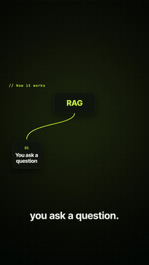
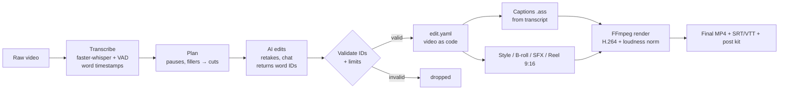

# Euphoria — AI Video Editor

Transcript-driven, offline-first AI video editor for Indian creators. Turn a raw talking-head clip, a screen
recording, or just a topic into a finished 9:16 reel with captions, motion graphics, sound and voice-over.
Built by **Team Euphoria** for the **AI BHOOMI** programme.

## Sample videos

Made end to end by Euphoria (no manual editing). Click a preview to open the video (with sound).

| Talking head · Malayalam | Talking head · title intro | No talking head · Devices | No talking head · Presenter | No talking head · Editorial | No talking head · Explainer |
|:---:|:---:|:---:|:---:|:---:|:---:|
| [](docs/samples/talking-head-malayalam.mp4) | [](docs/samples/talking-head-title.mp4) | [](docs/samples/faceless-devices.mp4) | [](docs/samples/faceless-presenter.mp4) | [](docs/samples/faceless-editorial.mp4) | [](docs/samples/faceless-explainer.mp4) |
| Big word behind the speaker, title cards, Malayalam captions, panels that build with the words | Title card, Malayalam + English captions | Phones, code, timelines and graphs from a topic, ElevenLabs voice | Cartoon host who talks along, numbered app windows | Notepad, huge type, magnifier, polaroids | Kinetic text and how-it-works graphics |

Samples are up to the first 30 s at 540×960 (`docs/samples/`).

**Demo:** _TODO — add live demo link_ · **Demo video:** _TODO — add 2-minute recording link_

---

## Problem statement

Indian creators and educators spend hours per video cutting pauses, fumbles and retakes, and captioning by hand.
Existing AI editors are built for English-speaking marketing teams, handle Malayalam and code-mixed (Manglish)
speech poorly, and stop at the edit instead of helping the creator grow.

## Users & context

- **Primary:** Malayalam and Manglish talking-head creators (Instagram Reels, YouTube Shorts and long-form).
- **Secondary:** educators (teachers, coaching institutes) and small businesses using the same talking-head format.
- **Context:** creators often record on phones, edit on modest Windows PCs, and mix Malayalam, Hindi and English
  in one sentence. The app runs locally on the creator's PC; AI features use an API key or the team's Claude account.

## Solution overview

Upload a raw clip → the app transcribes it with word timestamps → suggests cuts (long pauses, fillers, retakes)
→ you click words to cut/restore or type edits in chat ("make a 30-second reel of the best part") → it renders an
MP4 with captions, evened audio and optional style, b-roll, sound and 9:16 reel format.

The edit is stored as **video as code** (`edit.yaml`): the AI only proposes word IDs and settings, and FFmpeg
renders deterministically.



| Module | File(s) | Role |
|---|---|---|
| Transcribe | `app/editor/transcribe.py` | faster-whisper, per-language models, optional OpenAI whisper-1 |
| Plan | `app/editor/plan.py` | removed words + long pauses → cut list (`edit.yaml`) |
| AI edits | `app/editor/aiedit.py`, `app/editor/llm.py` | retake detection, chat edits, ID validation |
| Captions | `app/editor/captions.py` | caption lines on edited timeline |
| Render | `app/editor/render.py` | single FFmpeg pass |
| Finishing | `style.py`, `timeline.py`, `broll.py`, `sfx.py` | titles, keyword pops, b-roll, synthesised SFX, music ducking |
| Reels / growth | `reel.py`, `montage.py`, `grow.py`, `extras*.py` | 9:16 reels, beat-sync montage, starter kit & scripts, exports |
| Claude reel studio | `app/reel_agent/creator-reel/` | one Claude call returns a JSON plan; build + render without AI |
| Edit styles | `app/reel_agent/styles/` | talking head · product (screen recordings) · no talking head (topic/script), each with its own skill, planner rules and preset |
| Scene library | `app/reel_agent/creator-reel/templates/scenes.js` | hand-built scenes for the no-talking-head looks (devices, stick-figure story, editorial objects, cartoon presenter) |
| Voice-over | `app/editor/tts.py` | ElevenLabs text-to-speech with word timings, cached per line |
| Web | `app/editor/server.py`, `app/web/` | FastAPI backend + review page; landing page in `website/` |

Full feature details: [`app/README.md`](app/README.md). Business plan and pitch: [`docs/`](docs/).

## Setup & run

Tested on Windows 10/11. Needs Python 3.12, FFmpeg, and (for the reel studio) Node.js + Claude Code.

1. **Clone**
   ```
   git clone https://github.com/Sakhil-N-Maju/Euphoria_ai_boomi.git
   cd Euphoria_ai_boomi
   ```
2. **Runtimes** — either:
   - *Portable (what `run.bat` expects):* put portable Python in `tools/python/`, FFmpeg in `tools/ffmpeg/bin/`,
     Node in `tools/node/`; or
   - *System install:* install Python 3.12, FFmpeg (on `PATH`) and Node.js.
3. **Python packages**
   ```
   pip install -r app/requirements.txt
   ```
4. **Speech-to-text models** (one time, ~1.5 GB for Malayalam) — run `app\download_models.bat`
   (or `python app/download_models.py`). Models land in `models/`.
5. **Keys (optional)** — copy `app/.env.example` to `app/.env` (never commit it) and fill in what you use:
   - `LLM_API_KEY` — AI edits in the classic editor (any OpenAI-compatible provider; model in `app/config.yaml`
     or `LLM_MODEL`).
   - `ELEVENLABS_API_KEY` — AI voice-over for *No talking head* and *Product* reels (see
     [ElevenLabs voice-over](#elevenlabs-voice-over-optional)).
6. **Run**
   - Portable: double-click `app\run.bat`
   - System Python: `cd app` then `python -m editor.server`

   Open http://127.0.0.1:8000 (editor) or http://127.0.0.1:8000/site (website + Claude reel studio).
7. **Reel studio** — run `app\setup_reel.bat` once (render tools, fonts, Chromium for graphics, cut-out model),
   or use the "Set up this PC" panel on `/site`. The panel also installs Claude Code and signs it in: the reel
   planner is one `claude -p` call per reel.
   Then open http://127.0.0.1:8000/site → **Studio**, pick a style (and a look for *No talking head*), upload or
   type your script, and press **Make my reel**. Use **Ask for a change** (optionally with a time range) to fix a
   part; only that part is re-rendered.
   After updating the code, **restart the app** (close its window and run it again) and hard-refresh the page
   (Ctrl+Shift+R): the planner runs inside the server, so old code stays loaded until a restart.
8. **CLI**
   ```
   app\edit.bat "C:\videos\talk.mp4" --lang ml --retakes
   ```
9. **Tests**
   ```
   cd app
   python -m unittest discover tests
   ```

## Models & data

| Item | Source | Licence |
|---|---|---|
| Whisper small (CTranslate2) | [Systran/faster-whisper-small](https://huggingface.co/Systran/faster-whisper-small) | MIT |
| Malayalam STT | [adalat-ai/ct2-whisper-medium-ml-rmft](https://huggingface.co/adalat-ai/ct2-whisper-medium-ml-rmft) | Apache-2.0 |
| Cloud STT (optional) | OpenAI `whisper-1` API | Provider terms |
| LLM for retakes / chat / b-roll / growth (optional) | Any OpenAI-compatible API; default `gpt-4.1-mini` | Provider terms |
| Reel planner | Claude via Claude Code (`claude -p`), signed-in account | Anthropic terms — team use only; public product needs API keys |
| Person cut-out | `u2net_human_seg` (rembg releases) | See rembg / U²-Net repos |
| Fonts | Fontsource / Google Fonts (incl. Noto Sans Malayalam) | SIL Open Font License |
| Sound effects | Synthesised in code (`app/editor/sfx.py`), no sample packs | Ours |
| Colour LUT "Look 01" | by @shakirc.ai | Not redistributed — kept out of git |
| Libraries | FastAPI, Uvicorn, faster-whisper, CTranslate2, NumPy, SciPy, OpenCV, ONNX Runtime, Playwright, PyYAML, FFmpeg | MIT / BSD / Apache-2.0 / LGPL (FFmpeg) |

**Data:** only self-recorded clips with consent are used for testing (`docs/samples/` holds sample outputs).
Third-party reference reels used to study editing styles stay on the team's PC and are not redistributed.
User videos stay on the user's PC and are **not** used for training. Uploaded jobs and renders live in
`app/data/` (git-ignored).

## Evaluation & guardrails

**Hallucination mitigations**
- The LLM never writes captions or video content: it only returns **word IDs** from the transcript.
  Captions always come from the transcript.
- Every returned ID is checked against the transcript; invalid IDs are dropped.
- Hard limits: one retake can remove ≤ 80 words; all retakes together ≤ 50 % of the video; no edit may cut every word.
- Length requests ("30-second reel") are verified after the edit and adjusted once if missed.
- Every AI change is shown in the transcript (e.g. retakes in yellow, corrected caption words underlined)
  and can be **undone**; "Restore original words" reverts caption fixes.
- Growth tools never invent numbers — estimates are labelled "est." — and never log into, scrape or act on
  Instagram.
- Claude reel planner reads only the transcript, has no tools, and must return JSON matching
  `prompts/plan_schema.json`; build and render are deterministic.

**Bias / fairness mitigations**
- Language-specific STT model for Malayalam instead of an English-centric default; language picked or auto-detected.
- Chat edits accepted in Malayalam, Hindi and English; keyword picking falls back to the AI for non-English speech
  (rule-based picks are English-biased).
- Colour looks grade b-roll only by default, so the presenter's skin tone is left untouched; Look 01 warns when
  footage isn't S-Log3.

**Evaluation**
- Unit tests in `app/tests/` (plan, AI-edit validation, finishing, reels/montage/grow, marketplace skills).
- `app/compare_stt.bat` compares Whisper small vs the Malayalam model vs whisper-1 on a clip (speed, timestamp
  sanity, transcripts for counting errors).
- "Review render" sends frames of the render to a vision model to list problems with timestamps.

## Edit styles and fast corrections (reel studio)

- **Pick a style** in the Studio: *Talking head* (your own video), *Product* (a screen recording of an app, website or
  product: framed window, auto-zoom on what moves, speed-ups, titles, logo outro, optional AI narration) or
  *No talking head* (just a topic or script; the AI can write the script; ElevenLabs voice, your own voice-over or
  the Windows computer voice; optional music).
  Each style's rules live in `app/reel_agent/styles/<style>/SKILL.md`, studied from reference reels (kept locally in
  `assets/style/`, not in the repo).
- **No talking head looks are scene families**, not just colours. The AI only picks a scene per moment and fills
  in short text (same single call, same token cost); every scene is drawn by code
  (`creator-reel/templates/scenes.js`):

  | Look | Scenes |
  |---|---|
  | **Devices** (dark) | tilted 3D phone (list / chat / big number), code editor typing line by line, editing timeline with playhead, self-drawing curve graph, glowing 3D word, comment-box CTA |
  | **Story** (navy neon) | stick figures with poses, props and ✓/✗ marks, neon tag boxes with strike-through, speech bubbles, line icons |
  | **Editorial** (paper) | torn notepad with handwriting and a red circled word, huge condensed word with underline and definition, magnifier revealing a phrase, pinned polaroids |
  | **Presenter** (light) | original cartoon host whose mouth moves with the voice, numbered app windows (typed prompt, folder, ticked checklist, chat) |

  Each scene item appears on the word where it's said, and each scene type has its own synthesized sound effects.
- **Captions never repeat the screen.** A caption line whose words are already shown by a scene, card, hook or CTA
  is left out; lines break where a graphic appears, and a line keeps one position for its whole life (no jumps).
- **Corrections touch only their part of the timeline.** Graphics frames and 2-second video chunks are cached by
  content; a fix re-renders only what changed and reuses the rest byte for byte (parts that only moved because a
  word was cut earlier are reused too). "Ask for a change" takes an optional time range; changes outside it are
  refused and listed.
- **Faster renders**: colour grade through a cached 3D lookup table (~5x), x264 `veryfast` per chunk in parallel
  workers, no second full encode when the reel already fits the size limit. Measured on a 2-core test machine
  (21 s reel): full render 362 s → ~125 s; a one-word spelling fix 22 s; cutting a word at 0:05 ~50 s.

## ElevenLabs voice-over (optional)

Used by *No talking head* (Voice → "ElevenLabs voice") and *Product* (Voice-over → "AI narration": the planner
writes one line per scene, the scene slows down if the line needs more time, the recording's own sound is muted).
1. ElevenLabs → Developers → API Keys → Create Key. Permissions: **Text to Speech: Access** and **Voices: Read**
   (lets the app pick a default voice from your account when no voice ID is given); everything else "No Access".
   Free plans can't use Voice Library voices through the API: use a default voice (My Voices) or your own.
2. Add to `app/.env` (never commit it): `ELEVENLABS_API_KEY=sk_...`
   Optional: `ELEVENLABS_VOICE_ID=<id from ElevenLabs → Voices → My Voices>` (otherwise the first default voice on
   your account) and
   `ELEVENLABS_MODEL=eleven_multilingual_v2|eleven_v3` (default: `eleven_v3` for Malayalam / auto-detect, which is the
   only ElevenLabs model with Malayalam; `eleven_multilingual_v2` for English, Hindi, Tamil).
3. Restart the app. A voice ID typed in the Studio overrides the default for that reel.
Word timings come with the audio (`with-timestamps` endpoint). Every spoken line is cached in
`app/data/reels/_cache/tts/`, so Retry and unchanged lines never use credits again.

## Known limitations & risks

- **STT accuracy:** Malayalam model's published WER ≈ 40 %; Whisper small is weak on Malayalam and code-mixed
  speech. Word-timestamp quality of the Malayalam model is undocumented — check cut points.
- **Speed:** the medium Malayalam model is several times slower than small on CPU.
- **Fillers:** Whisper often omits "um/uh"; short ones may survive the cut.
- **Single speaker / talking-head focus;** split-screen reframing assumes a centred face.
- **Rule-based keyword picks** work best in English.
- **Third-party AI dependency:** AI features need an API key or Claude account; cost and terms vary; Claude
  account mode is for team use only.
- **Licensing:** LUTs and some reused skill assets belong to others — LUTs are excluded from the repo; any
  reused code must keep its licence and attribution.
- **Privacy:** videos stay local, but transcripts (and frames, for Review render / b-roll matching) are sent to the
  chosen AI provider when AI features are used.
- **ElevenLabs:** voice-over needs an ElevenLabs key and uses its credits; free plans can't use Voice Library voices
  through the API.
- **Scene choice:** the AI picks scenes from the chosen look's list; a scene can still be a weaker fit for an
  abstract line. Use *Ask for a change* to swap it.
- **Not included:** dubbing, voice cloning, lip-sync.

## Team

**Team Euphoria**

| Name | Role | Contact |
|---|---|---|
| Sakhil N Maju | Backend & AI Lead — speech-to-text, edit-list logic, LLM prompts and guardrails, FFmpeg rendering, API | sakhil.n.maju123@gmail.com · [LinkedIn](https://linkedin.com/in/sakhil-n-maju) |
| Nima Fathima | Product & Frontend Lead — web UI and website, demo, pitch deck, README, presenting | nimafathimapr@gmail.com · [LinkedIn](https://www.linkedin.com/in/nimafathima) |

---

### Repository layout

| Folder | Contents |
|---|---|
| `app/` | Editor code, web UI, reel agent, CLI, tests |
| `website/` | Landing page |
| `docs/` | Startup plan, AIBoomi Kochi build plan, mentor pitch, pitch deck (PDF + PPTX) |
| `docs/samples/` | Sample reels (GIF previews + 30 s MP4s) shown above |
| `app/web/media/` | Clips for the landing-page 3D reel carousel |
| `assets/` | Local only: reference reels (`assets/style/`) and full-size outputs (`assets/output/`), git-ignored |

## License

[MIT](LICENSE) © 2026 Team Euphoria. Third-party models, fonts, LUTs and reused skill assets keep their own
licences (see *Models & data*); the MIT licence covers the team's own code.

Git-ignored (set up locally): `tools/`, `models/`, `app/data/`, `app/.env`, `app/luts/*.cube`, `assets/style/`,
`assets/output/`, `app/reel_agent/styles/*/refs/`.
